# Autonomous Mobile Robot - MATLAB Path Planning

Portfolio project: path planning in MATLAB/Simulink, with ROS 2 / Gazebo integration planned for a later stage.

## Status

| Step | Milestone | Status |
|------|-----------|--------|
| 1 | A* path planner on a 2D occupancy grid | Done |
| 2 | Physical resolution, robot footprint inflation, clearance-preserving path smoothing | Done |
| 3 | Reference trajectory and Pure Pursuit tracking (kinematic simulation, MATLAB only) | Done |
| 4 | Simulink model of the Step 3 loop and MATLAB-versus-Simulink validation | Done |

## Project layout

```
autonomous-mobile-robot/
  README.md, .gitignore
  src/                 Step 1 planner and helpers (createOccupancyMap, astarPlanner, ...)
    mapping/           Step 2: robotConfig, binaryOccupancyMap, inflation, endpoint checks
    smoothing/         Step 2: exact segment geometry and path smoothing
    analysis/          Step 2: path validation, toolbox comparison, plotting
    control/           Step 3: tracking config, reference trajectory, Pure Pursuit, simulation, metrics
    simulink/          Step 4: block functions, model builder, run and comparison helpers
  scripts/             run_step1_astar.m, run_step2_inflation_smoothing.m, run_step3_trajectory_tracking.m,
                       run_step4_simulink_validation.m, runWithLog.m (runs a script and saves its
                       console output to results/)
  simulink/            amr_step4_tracking.slx (generated by buildStep4Model, committed)
  tests/               testAStarPlanner.m, testStep2.m, testStep3.m, testStep4.m
  results/             stepN_log.txt, step2_comparison.csv, step3_metrics.csv,
                       step3_trajectory_log.csv, step4_comparison.csv, step4_scenarios.csv,
                       step4_simulink_log.csv, step4_heading_error_events.csv, figures/*.png
```

## Prerequisites

| Item | Requirement |
|------|-------------|
| Operating system | Windows 11 (all verification was done here; no Ubuntu run yet) |
| MATLAB | R2025a (25.1). The project was verified only on this release. It was originally planned for R2024b Update 5, which has **not** been tested |
| Navigation Toolbox | Steps 2 to 4 (`binaryOccupancyMap`, `inflate`, `plannerAStarGrid`) |
| Simulink | Step 4 only (the model, `Simulink.SimulationInput`, MATLAB Function blocks) |
| Anything else | Step 1 and the Step 3 unit tests need base MATLAB only. In a fresh run of everything, MATLAB checked out only the `matlab`, `navigation_toolbox` and `simulink` licences. No ROS, Gazebo or hardware is used |

## Setup and run order

1. Copy or clone the folder anywhere. All paths in the code are relative to the project; nothing is hard-coded.
2. Start MATLAB and make the project root the current folder.
3. Run the steps in order (each step is independent of the earlier results, but this is the order that was verified):

```matlab
cd('<path to>/autonomous-mobile-robot')   % project root
addpath('scripts')                          % the only path setup needed
runWithLog('run_step1_astar', 'step1_log.txt')                    % Step 1: A*, checks, figures
runWithLog('run_step2_inflation_smoothing', 'step2_log.txt')      % Step 2: inflation, smoothing, checks, figures
runWithLog('run_step3_trajectory_tracking', 'step3_log.txt')      % Step 3: Pure Pursuit simulation, checks, figures
runWithLog('run_step4_simulink_validation', 'step4_log.txt')      % Step 4: builds the .slx, runs it, compares with MATLAB
runtests('tests')                                                 % all 87 unit tests, run from the project root
```

- `runWithLog` runs a script, prints its output and saves it to `results/<log>`. Use it rather than `run(...)` if you want the log, because MATLAB's `diary` records nothing when MATLAB is driven through the MCP server.
- Each script starts with `clear; clc; close all;`. Run directly, it clears your workspace; `runWithLog` runs it in its own workspace.
- The scripts add `src/` and its subfolders to the path themselves, and the tests do the same through a path fixture. Do not use `savepath`.
- Running a script rewrites its files in `results/` (and Step 4 also rebuilds `simulink/amr_step4_tracking.slx`). All results are deterministic apart from the timing lines in the logs.
- Single test files: `runtests('tests/testStep4.m')` and so on.

### Running the Simulink model by hand

The model reads its parameters from base-workspace variables, so opening it and pressing Play fails until they exist. `runSimulinkTracking` sets them for each run. To use the model interactively:

```matlab
addpath(genpath('src'))
sc = buildStep3Scenario();
assignin('base', 's4ref', sc.ref);              % reference trajectory
assignin('base', 's4cfg', sc.tcfg);             % trackingConfig
assignin('base', 's4env', sc.env);              % clearance environment (real obstacles)
assignin('base', 's4startPose', sc.startPose);  % [x y theta] in m, m, rad
assignin('base', 's4dt', sc.tcfg.sim.timeStep); % 0.02 s
assignin('base', 's4stopTime', sc.tcfg.sim.timeoutFactor * sc.ref.duration + sc.tcfg.sim.timeoutPad + 3 * sc.tcfg.sim.timeStep);
open_system('simulink/amr_step4_tracking.slx')
out = sim('amr_step4_tracking');                % out.sl_log: one row per step, columns per slLogLayout()
```

Units throughout: metres, seconds, radians; grid coordinates are [row col] with row 1 at the top; world coordinates are [x y] with the origin at the bottom-left of the map.

## Step 1 - A* planner

A from-scratch A* implementation (no built-in planner) on an 8-connected grid:

- Orthogonal moves cost 1, diagonal moves cost sqrt(2)
- Diagonal moves may not cut across obstacle corners (optional flag `AllowCornerCutting`, off by default)
- Octile-distance heuristic (admissible and consistent)
- Returns the path, its length, the expanded nodes and a clean `found = false` result when no path exists

| Metric (default 40 x 60 map) | Value |
|------------------------------|-------|
| Path length | 73.2548 cell units (61 cells) |
| Expanded nodes | 807 of 1964 free cells |
| Dijkstra cross-check (h = 0) | same length, 1565 expanded nodes |
| No-path map | `found = false`, 1915 nodes expanded, no error |

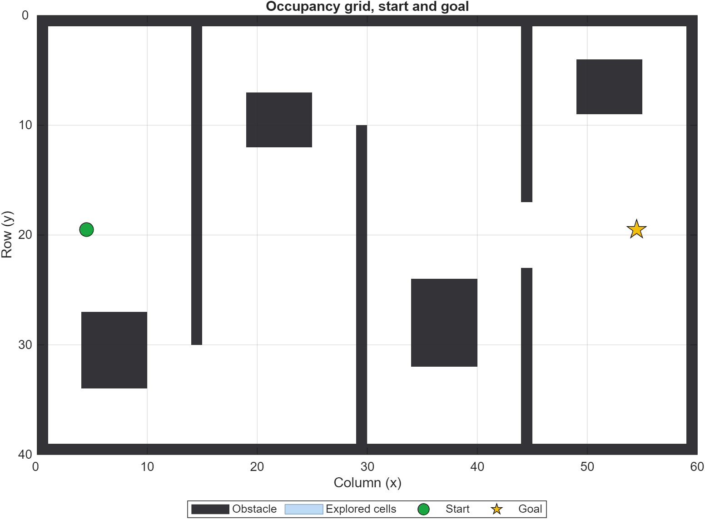
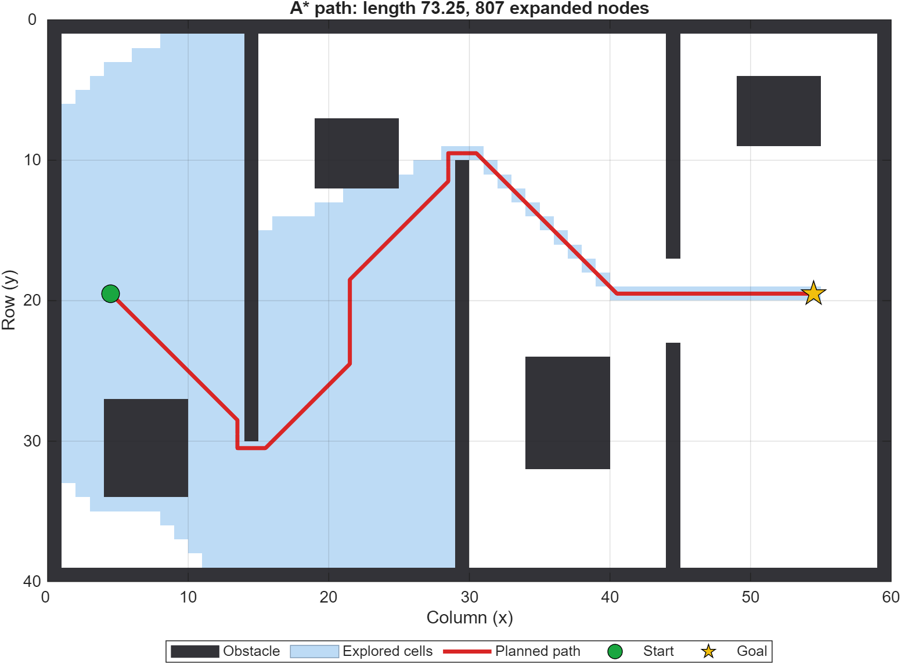
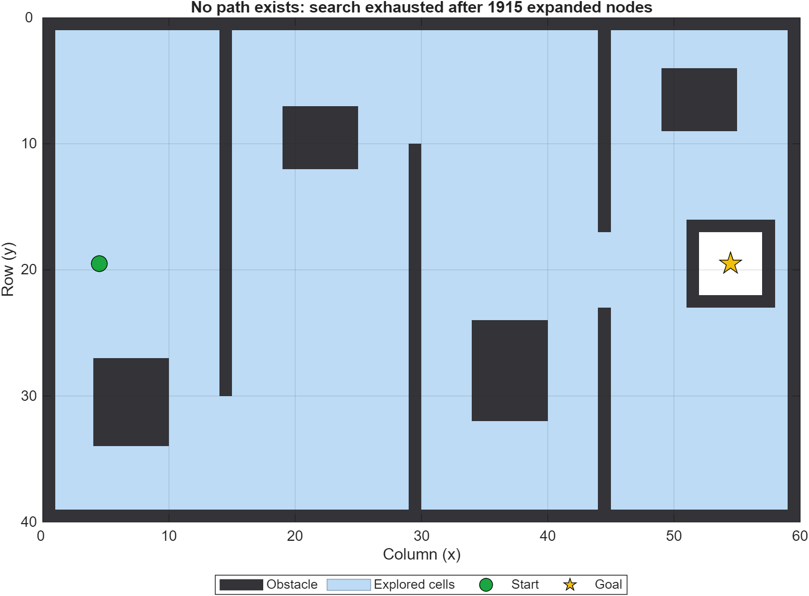

## Step 2 - Resolution, footprint clearance and smoothing

### Configuration (`robotConfig`)

| Parameter | Value |
|-----------|-------|
| Cell size | 0.25 m/cell (`binaryOccupancyMap` resolution = 4 cells/m) |
| Arena | 40 x 60 cells = 10 m x 15 m |
| Robot radius | 0.20 m (circular footprint, 0.40 m diameter) |
| Safety margin | 0.05 m |
| Inflation | 0.25 m = exactly 1 cell (requested radius is rounded up to whole cells) |

The toolbox expects resolution in cells per metre, so `resolution = 1 / cellSizeM`. The Step 1 grid is unchanged; 0.25 m/cell was chosen so its 4-cell passages (1.0 m) are wide enough for the robot.

### Pipeline

1. `buildBinaryOccupancyMap` wraps the Step 1 grid in a `binaryOccupancyMap`.
2. `inflateObstacles` inflates a copy by robot radius + margin.
3. `assertEndpointsFree` raises a clear error if start or goal is out of bounds, inside an obstacle, or inside the inflated region. Endpoints are never moved silently.
4. `astarPlanner` (the Step 1 code) plans on the inflated grid.
5. `smoothPath` applies greedy line-of-sight shortcutting. A shortcut is accepted only if the segment crosses only free inflated cells (exact intersection test) and stays at least radius + margin from every real obstacle (exact segment-to-square distance).
6. `validatePathClearance` re-checks every segment, plus an independent dense-sampling check.

### Results

| Path | Waypoints | Length (m) | Min clearance (m) | Passes all checks |
|------|-----------|------------|-------------------|-------------------|
| Step 1 path, plain map (no inflation) | 61 | 18.314 | 0.125 | No (clearance < 0.20 m robot radius) |
| A* grid path, inflated map | 68 | 19.753 | 0.375 | Yes |
| Smoothed path | 9 | 19.092 | 0.375 | Yes |
| `plannerAStarGrid` (toolbox) | 64 | 19.167 | 0.354 | No (5 corner-cutting segments, see below) |

Inflation grows the obstacles from 436 to 918 cells (18.2% to 38.2% of the map). A* on the inflated map expands 681 nodes. Smoothing reduces 68 waypoints to 9 and shortens the path by 0.66 m (3.4%) while keeping the full clearance.

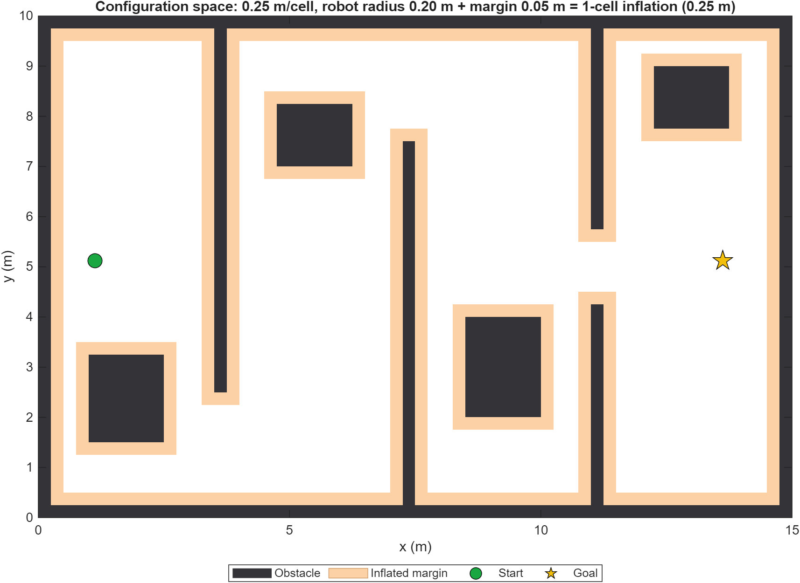
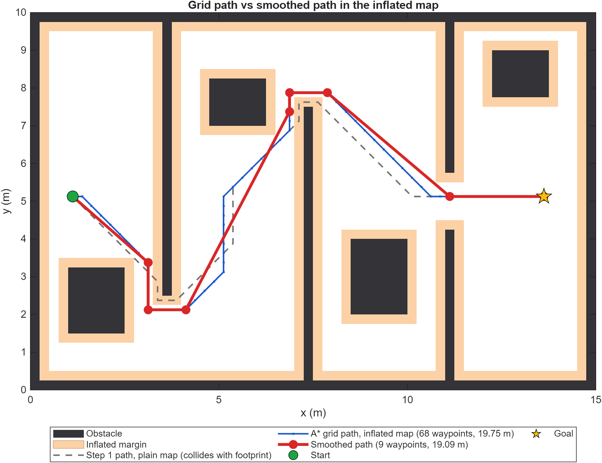
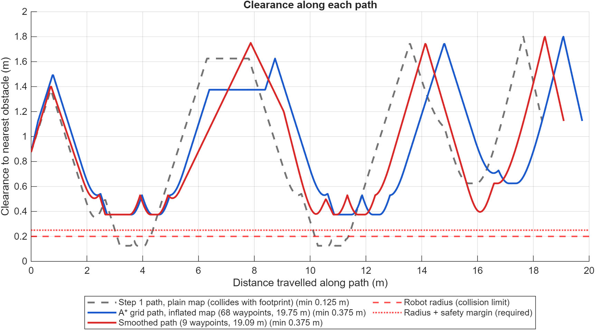

### Comparison with Navigation Toolbox `plannerAStarGrid`

On the same inflated map:

| Planner | Length (m) | Expanded | Corner-cutting steps |
|---------|------------|----------|----------------------|
| Ours (no corner cutting, Step 1 rules) | 19.753 | 681 | 0 |
| Ours with `AllowCornerCutting = true` | 19.167 | 675 | 6 |
| `plannerAStarGrid` default | 19.167 | 858 | 5 |
| `plannerAStarGrid` with `TieBreaker = on` | 19.753 | 807 | 4 |

- With corner cutting enabled, our planner and the toolbox find paths of identical cost (difference ~1e-14 m), but not identical cells, because ties are broken differently. The toolbox expands more nodes (858 vs 675).
- The toolbox allows diagonal moves between two diagonally touching obstacle cells. Our default rules forbid that, so the toolbox path is 0.59 m (3.0%) shorter. Under our conservative exact segment test those 5 segments count as blocked, even though the toolbox path still keeps 0.354 m clearance from real obstacles.
- `TieBreaker = on` returned a path 3.1% longer than the default setting, i.e. not optimal for its own corner-cutting rules. This was observed but not investigated.

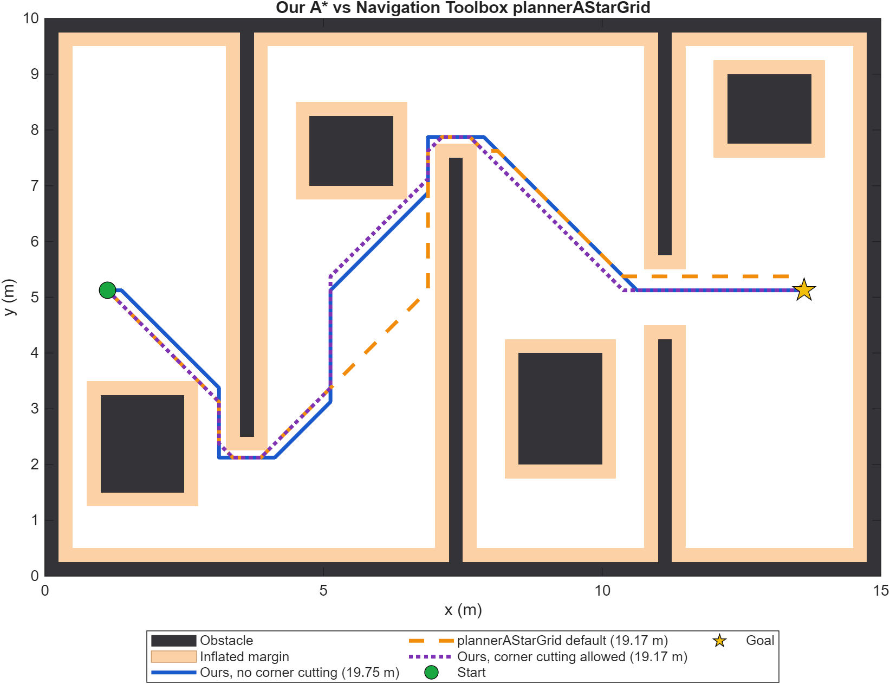

### Failure cases handled

| Case | Behaviour |
|------|-----------|
| Start or goal inside the inflated region | Error `amrStep2:endpointInInflatedRegion` naming the cell, its world position and the inflation |
| Start or goal inside a real obstacle | Error `amrStep2:endpointInObstacle` |
| Start or goal outside the map | Error `amrStep2:endpointOutOfBounds` |
| Robot too large for the passages (0.45 m radius + 0.05 m margin) | Planner returns `found = false` with an empty path, no error |
| Negative radius or margin, non-positive cell size | Rejected by argument validation |

### Tests

`tests/testStep2.m` has 32 tests covering configuration, resolution and coordinate conversion, inflation (kernel shape, floating-point rounding, monotonic growth), endpoint errors, exact segment geometry (checked against brute-force sampling), smoothing, path validation failures, the toolbox comparison and a Step 1 regression check.

## Step 3 - Trajectory generation and Pure Pursuit tracking

A unicycle (differential-drive-compatible) robot follows the Step 2 smoothed path in a **kinematic simulation**. Step 3 is MATLAB only (Simulink is added in Step 4); there is no ROS 2 or hardware, and nothing here is dynamic or physical validation.

### Model

```
x_dot = v*cos(theta)    y_dot = v*sin(theta)    theta_dot = omega
```

- Integrated exactly (circular arc) for piecewise-constant commands every 0.02 s.
- Commands pass through actuator limits: speed, yaw rate, wheel speeds (v -/+ omega*track/2), linear and angular acceleration.
- Not modelled: wheel slip, motor dynamics, delay, sensor noise, localisation error, tyre or payload effects.
- World frame: metres, origin at the bottom-left of the map, x right, y up. Step 2 grid cells convert with `gridCoordsToWorld`.

### Reference trajectory (`generateReferenceTrajectory`)

1. **Geometry:** the path stays exactly on the Step 2 polyline. Linear interpolation is used on purpose, because every segment of that polyline was collision-checked and a spline would leave the validated corridor. Samples every 0.05 m and at every waypoint.
2. **Heading:** segment tangent, blended linearly across each corner over 0.8 m (at most half of each adjacent segment), so heading and curvature stay finite. Inside a blend window the heading is not exactly the polyline tangent.
3. **Speed:** the smallest of the top speed, sqrt(lateral accel limit / |curvature|), yaw-rate limit / |curvature| and the wheel-speed limit, with a floor of 0.15 m/s in turns. A forward-backward pass then enforces the acceleration limit, with zero speed at start and end.
4. **Time:** constant acceleration between samples, dt = 2 ds / (v1 + v2). Output: s, t, x, y, heading, curvature, v, omega.

The profile respects the stated kinematic limits. That is all it shows; it does not show that a real robot could execute it.

### Pure Pursuit (`purePursuitController`)

1. Project the robot onto the reference polyline (search window starts at the previous progress, so progress never moves backwards). This gives progress `sProj` and the signed cross-track error.
2. Lookahead `Ld = clip(0.30 + 0.8*v, 0.30, 1.20)` m, measured along the path from `sProj` and clamped to the final point.
3. `alpha = wrap(bearing to lookahead point - heading)`, `l` = distance to that point, curvature `kappa = 2*sin(alpha)/l` (`kappa = 0` if `l` is about 0).
4. Speed: reference speed at `sProj`, at least 0.05 m/s (creep speed so the goal tolerance is reached), scaled by `cos(alpha)`. `omega = v*kappa`.
5. If `|alpha|` exceeds 80 deg the robot turns on the spot (`v = 0`, `omega` proportional to `alpha`).
6. `limitVelocityCommand` enforces speed, yaw-rate and wheel-speed limits while preserving the commanded curvature.

The robot follows the path by progress along it, not by clock time; the reference time is logged but not enforced.

### Parameters (`trackingConfig`, all overridable by name-value pairs)

| Group | Parameter | Value |
|-------|-----------|-------|
| Robot | max speed / yaw rate | 0.60 m/s / 1.50 rad/s |
| Robot | max acceleration / yaw acceleration | 0.50 m/s^2 / 3.00 rad/s^2 |
| Robot | track width / max wheel speed | 0.34 m / 0.80 m/s |
| Reference | lateral acceleration limit / turn speed floor | 0.40 m/s^2 / 0.15 m/s |
| Reference | sample spacing / corner blend | 0.05 m / 0.80 m |
| Controller | lookahead min, gain, max | 0.30 m, 0.8 s, 1.20 m |
| Controller | rotate-in-place threshold, gain | 80 deg, 2.0 1/s |
| Controller | creep speed / goal tolerance | 0.05 m/s / 0.10 m |
| Simulation | time step | 0.02 s |
| Simulation | timeout | 2 x reference duration + 10 s |
| Simulation | divergence / stall | cross-track above 0.50 m / progress below 0.05 m over 5 s |

The values are hand-chosen defaults, not optimised. Invalid values (non-positive, non-finite, or inconsistent such as lookahead min above max) raise `amrStep3:invalidConfig` or a validation error.

### Goal handling and termination

When the robot is within 0.10 m of the final point (and at the end of the path) it brakes to a standstill using the acceleration limit. Success requires it to stop within 0.10 m of the goal. Termination reasons:

| Reason | Meaning |
|--------|---------|
| `goal_reached` | stopped within the goal tolerance |
| `missed_goal` | entered the tolerance but came to rest outside it |
| `timeout` | time limit exceeded |
| `stalled` | no progress along the path |
| `diverged` | cross-track error above the limit |
| `collision` | clearance to a real obstacle below the robot radius |
| `left_map` | robot centre outside the map |
| `numerical_failure` | NaN or Inf pose or command |

### Metric definitions

- **Cross-track error:** signed distance from the robot centre to the nearest point of the reference polyline (positive = left of the path direction). Past the end of the path the nearest point is the end point, so a stop a few millimetres beyond the goal shows up as cross-track error.
- **Heading error:** wrap(reference heading at the nearest path point - robot heading), wrapped to [-pi, pi]. Also reported after the robot first comes within 30 deg, to separate a large initial error.
- **Clearance:** exact distance from the robot centre to the nearest occupied cell of the ORIGINAL map (cells as full squares), at every simulation step. Collision: below the 0.20 m robot radius. Clearance violation: below 0.25 m (radius + margin, the Step 2 requirement).
- **Acceleration:** change of the applied velocity between consecutive samples divided by the time step, over all samples including the first step from rest and the last step. Checked against the limit with a tolerance of 1e-9.
- **Distance travelled:** sum of straight-line distances between consecutive poses. **Final position error:** distance from the last position to the goal.

### Results (default scenario, `run_step3_trajectory_tracking.m`)

Scenario A starts at the Step 2 start cell centre, heading along the first path segment. Scenario B is the same start with a 120 deg initial heading error.

| Metric | A (nominal) | B (120 deg heading error) |
|--------|-------------|---------------------------|
| Termination | `goal_reached` | `goal_reached` |
| Duration (reference 34.45 s) | 34.02 s | 36.22 s |
| Distance travelled (path 19.09 m) | 18.511 m | 18.570 m |
| Final position error | 0.0055 m | 0.0056 m |
| Cross-track error, max / RMS | 0.175 m / 0.044 m | 0.173 m / 0.057 m |
| Max heading error | 36.1 deg | 120.0 deg (36.1 deg after alignment at 2.86 s) |
| Max linear / angular speed | 0.600 m/s / 0.903 rad/s | 0.600 m/s / 1.500 rad/s |
| Max applied acceleration | 0.500 m/s^2 / 3.000 rad/s^2 | 0.500 m/s^2 / 3.000 rad/s^2 |
| Final speed | 0 | 0 |
| Min clearance to real obstacles | 0.2752 m | 0.2779 m |
| Collision / clearance violation | no / no | no / no |

- Both runs reach the goal, never collide, and keep at least the required 0.25 m clearance at every step. The margin is small: 2.5 cm in scenario A.
- The lookahead cuts corners. The reference path keeps 0.375 m from obstacles, and the actual path gets as close as 0.275 m. The maximum cross-track error (0.175 m) is above the 0.125 m that would on its own guarantee the required clearance (0.375 - 0.25), so the exact clearance check is what decides pass or fail, and it passes.
- The applied accelerations equal the limits (0.5 m/s^2, 3 rad/s^2) because the actuator model saturates; they do not exceed them.
- An earlier version of the simulation set the speed to zero the instant the goal tolerance was entered (about 0.3 m/s, an implied deceleration of about 16 m/s^2) and excluded that sample from the acceleration check. That was wrong and has been replaced by braking within the limit.

Failure cases, each ending safely with its own reason and never as success: a time limit that is too short (`timeout`); a robot that is only allowed to brake at 0.3 m/s^2 while the reference assumes 0.5 stops 0.231 m past the goal (`missed_goal`); no creep speed at the zero-speed start (`stalled`); a start 1 m off the path (`diverged`); a start inside the robot radius of an obstacle (`collision`). Starting outside the map (`left_map`) and a NaN pose (`numerical_failure`) are covered in the unit tests.


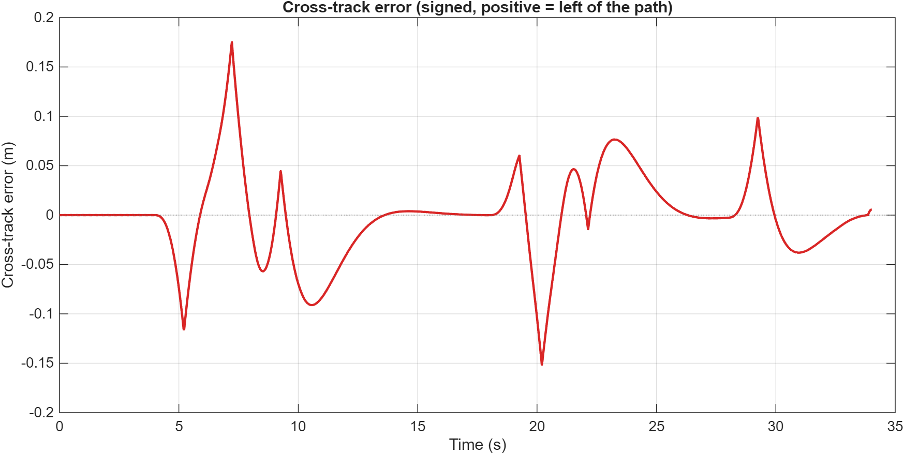
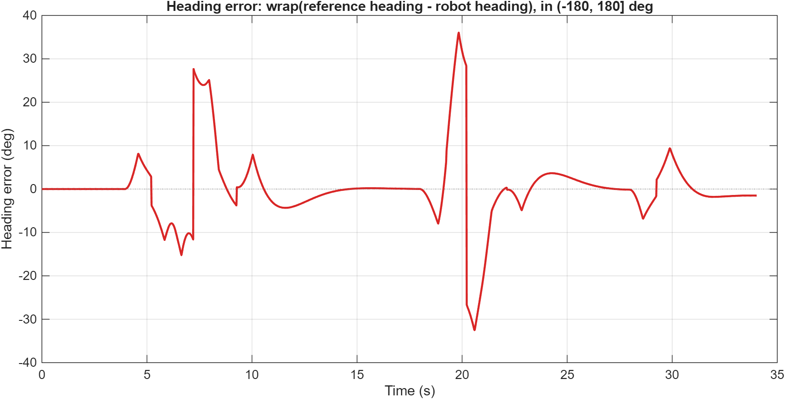
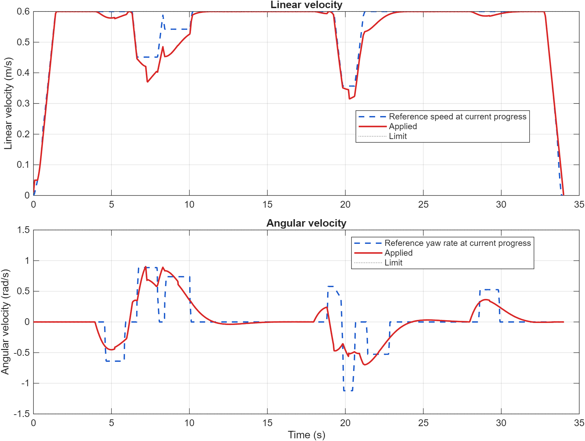
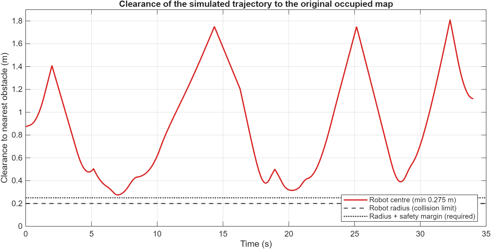
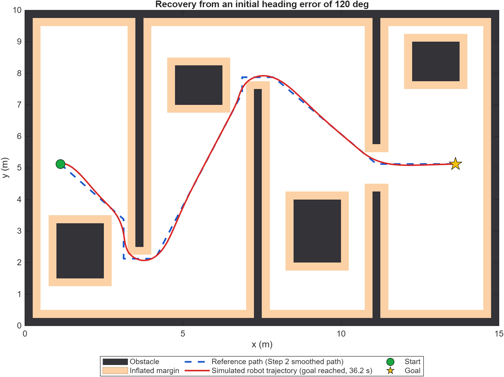
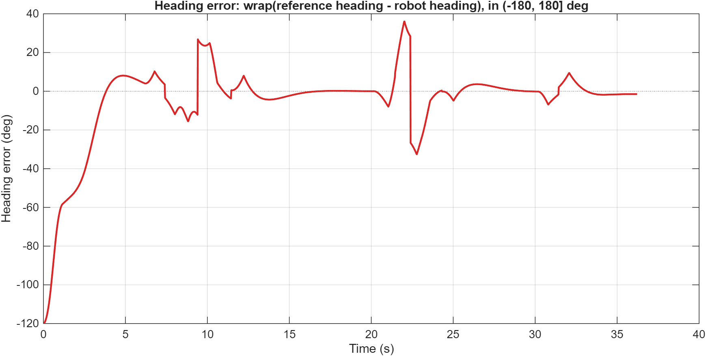

Logs: `results/step3_log.txt` (full console output and check summary), `results/step3_metrics.csv`, `results/step3_trajectory_log.csv` (pose, reference pose, velocities, errors and clearance at every step of scenario A).

### Step 3 tests

`tests/testStep3.m` has 26 tests: reference properties (limits, rest at both ends, slowing at corners, waypoints, invalid and degenerate paths), straight and turning path tracking, initial heading errors (including facing backwards), braking and acceleration limits, `missed_goal`, velocity-limit enforcement, signed cross-track and wrapped heading error, a zero-distance lookahead, exact clearance calculation, clearance and collision classification against the real map, invalid configurations and poses, timeout, stall, divergence and leaving the map, and consistency of the metrics with the log.

### Step 3 limitations

- Kinematic simulation only. There is no dynamics, slip, latency, noise or localisation error, and no real-hardware validation.
- The 2.5 cm clearance margin in the nominal run is thin. Pure Pursuit cuts corners; a different lookahead, a larger safety margin or a path that is planned with more clearance would give more room. The parameters were not optimised.
- The reference is a polyline with blended heading, not a smooth curve, and its heading is not exactly tangent to the path inside corner windows.
- Lateral acceleration can exceed its limit where the turn-speed floor applies (not reached in the default scenario, where the maximum is 0.400 m/s^2).
- The robot does not follow the reference clock; it follows progress along the path.
- The clearance check samples the pose at every 0.02 s step (at most 1.2 cm apart) rather than checking the continuous arcs; the chord-versus-arc error is far below the cell size.
- Cross-track error is measured to the polyline including its end points (see the definition above).
- Static, known map only: no replanning, dynamic obstacles or obstacle sensing.
- Console logs are saved by `runWithLog`. MATLAB's `diary` records nothing when MATLAB is driven through the MCP server, so the Step 1 and 2 log files saved earlier were empty; they have been regenerated with `runWithLog`.

## Step 4 - Simulink model and MATLAB-versus-Simulink validation

The Step 3 closed loop (unicycle, Pure Pursuit, actuator limits, goal-stop logic) is rebuilt as a Simulink model and compared with the MATLAB simulation. Three claims are kept separate:

| Level | Meaning | Status |
|-------|---------|--------|
| Build | `simulink/amr_step4_tracking.slx` is created and the diagram compiles (algebraic loops, unconnected lines and dimension problems are set to errors) | Done |
| Simulation | the model runs to a termination in every scenario without errors or warnings | Done |
| Numerical validation | results agree with the MATLAB baseline within tolerances fixed in advance | Done, see below for what this does and does not show |

This is a kinematic simulation only: no dynamics, no hardware, no code generation. The model was only run in Simulink Normal mode.

### Model architecture

Fixed-step discrete solver, one step of 0.02 s (the Step 3 control period), all state in Unit Delay blocks:

| Block | Role |
|-------|------|
| `PoseState`, `ProgressState`, `ActuatorState` | Unit Delays holding [x; y; theta], progress along the path, and the [v; omega] applied at the previous step |
| `Environment_Clearance` | exact clearance to the real (uninflated) obstacles and a map-bounds flag |
| `Controller_PurePursuit` | the existing `purePursuitController`, unchanged |
| `Supervisor_GoalStop` | braking at the goal, `goal_reached` / `missed_goal`, timeout, stall, divergence, collision, left map, numerical failure |
| `Actuator_Limits` | acceleration limits, then the existing `limitVelocityCommand` |
| `Plant_UnicycleKinematics` | x_dot = v cos(theta), y_dot = v sin(theta), theta_dot = omega, via the existing exact-arc `stepUnicycle` |
| `Logging` and `sl_log` | packs 27 signals per step into one logged matrix (`slLogLayout`) |
| `StopOnTermination` | Stop Simulation block driven by the supervisor |

The blocks are MATLAB Function blocks whose bodies are thin calls into `src/simulink/` (`slPurePursuitStep`, `slSupervisorStep`, ...). Parameters come from workspace variables (`s4ref`, `s4cfg`, `s4env`, `s4startPose`, `s4dt`, `s4stopTime`) that `runSimulinkTracking` sets for each run, so the model cannot be run by pressing Play without defining them. `buildStep4Model` regenerates the `.slx` file.

What is reused and what is new: `purePursuitController`, `limitVelocityCommand`, `stepUnicycle` and `clearanceAtPoints` are the Step 3 functions, unchanged. The goal-stop decision chain (`slSupervisorStep`) and the slew-rate part of the actuator (`slActuatorStep`) are separate implementations of the logic inside `simulateUnicycleTracking`, and the agreement below is what checks them.

### Tolerances (fixed before running, `step4Tolerances`)

| Quantity | Tolerance |
|----------|-----------|
| Positions, progress, cross-track error, clearance, times | 1e-9 m (s) |
| Headings, heading error, lookahead angle (compared after wrapping) | 1e-9 rad |
| Commanded and applied velocities | 1e-9 (m/s, rad/s) |
| Scalar summary metrics | 1e-9 |
| One-step pose error against an independent `ode45` integration | 1e-9 |
| Step count, termination reason, braking onset step, rotating flag | exact match |

### Results

Scenario A (nominal start): the largest difference between the MATLAB and Simulink logs over all 24 compared signals and all 1702 samples is exactly 0. Both runs take 1702 steps, begin braking at step 1669, and end in `goal_reached`.

| Metric | MATLAB | Simulink | Difference |
|--------|--------|----------|------------|
| Final position error | 0.005495 m | 0.005495 m | 0 |
| Distance travelled | 18.511 m | 18.511 m | 0 |
| Cross-track error, max / RMS | 0.1750 / 0.0440 m | 0.1750 / 0.0440 m | 0 |
| Max heading error | 36.06 deg | 36.06 deg | 0 |
| Max linear / angular speed | 0.600 m/s / 0.903 rad/s | 0.600 m/s / 0.903 rad/s | 0 |
| Max applied acceleration (including the final braking) | 0.500 m/s^2 / 3.000 rad/s^2 | 0.500 m/s^2 / 3.000 rad/s^2 | 0 |
| Final speed | 0 | 0 | 0 |
| Minimum clearance to the real map | 0.2752 m | 0.2752 m | 0 |
| Goal outcome | `goal_reached` | `goal_reached` | same |

How to read an exact zero: both versions run the same Step 3 functions in IEEE double arithmetic, so agreement to rounding was expected, and it was exact. It shows that the Simulink structure (state feedback through the delays, timing, the supervisor and actuator logic, logging and stopping) reproduces the MATLAB loop. It does not independently validate the control algorithm, because the algorithm is shared. Three further checks show the comparison is meaningful:

- **Sensitivity:** with the lookahead minimum changed from 0.30 m to 0.50 m only in Simulink, the logs differ by up to 3.085 and the comparison flags it; with the same change in both, they still agree exactly.
- **Independent plant check:** the logged poses were advanced one step at a time with `ode45` (RelTol 1e-12). The largest deviation is 2.1e-12 m and 1.1e-15 rad, against the closed-form arc in the plant block.
- **Determinism:** two Simulink runs give identical logs.

Other scenarios, each run in both implementations with identical logs (difference 0) and the same termination reason:

| Scenario | Result | Steps |
|----------|--------|-------|
| B: 120 deg initial heading error | `goal_reached` | 1812 |
| Time limit 0.2 x reference | `timeout` | 346 |
| Brakes at 0.3 m/s^2 while the reference assumes 0.5 | `missed_goal`, stops at rest outside the tolerance | 1751 |
| No creep speed | `stalled` | 251 |
| Start 1.5 m off the path | `diverged` | 1 |
| Start 0.10 m from a wall | `collision` | 1 |
| Start outside the map | `left_map` | 1 |
| NaN start pose | `numerical_failure` | 1 |

A `timeout` ends with the robot still moving (0.43 m/s in the logged data); an emergency stop is assumed after the last sample, as in the MATLAB simulation.

### The jumps in the heading-error plots

Heading error is wrap(reference heading at the projected point - robot heading). `analyzeHeadingErrorJumps` checks every step whose change exceeds what smooth motion can produce (0.1015 rad per step, from the speed, yaw-rate and path-curvature limits) against four possible causes. In Scenario A there are three such steps, and all three are the same thing:

| Time | Heading-error step | Progress step | Geometric prediction 2 d tan(phi/2) | Robot moves at most |
|------|--------------------|---------------|-------------------------------------|---------------------|
| 5.20 s | -0.117 rad | 0.118 m | 0.105 m (corner 2, 48.8 deg) | 0.012 m per step |
| 7.20 s | +0.686 rad | 0.358 m | 0.343 m (corner 3, 90 deg) | 0.012 m per step |
| 20.20 s | -0.962 rad | 0.310 m | 0.303 m (corner 6, 90 deg) | 0.012 m per step |

- **Cause: projection jumps.** The robot cuts the inside of a corner. At that point two path segments are equally close, and the nearest point on the path flips from one to the other, moving the projected progress by about 2 d tan(phi/2) in one step (d is the cross-track distance, phi the corner turn angle). The reference heading is evaluated at that new point, so the error steps. The measured progress jumps match the geometric prediction to within 15%.
- **Not angle wrapping.** The error never exceeds 36 deg in Scenario A (120 deg in Scenario B), and no step crosses the +/-pi branch cut.
- **Not a discontinuous reference.** The reference heading is continuous: at most 0.157 rad between samples 0.05 m apart (curvature up to 3.14 1/m, a short segment between two corners).
- **Not the robot.** The robot heading changes by at most 0.018 rad per step.
- **Counterfactual:** limiting the progress to the top speed removes the steps (largest step 0.028 rad instead of 0.962 rad).
- **Effect on the controller:** the jump also moves the lookahead point, so the desired angular velocity steps by up to 1.05 rad/s in one step. The actuator rate limit (3 rad/s^2) smooths this to 0.06 rad/s per step before it reaches the robot, so the robot motion is smooth and only the logged error and the desired command show the discontinuity.
- Scenario B shows the same three events (7.40, 9.40, 22.38 s). In the last 8 samples of Scenario A the logged lookahead angle is about -179.6 deg and the turn-on-the-spot flag is set, because the robot has stopped 5 mm past the end point and the final lookahead point is behind it; the braking logic overrides the command, so this has no effect.

The MATLAB baseline was not changed. If smoother logged errors or commands are wanted later, options are hysteresis or rate limiting on the projection; this is not implemented.

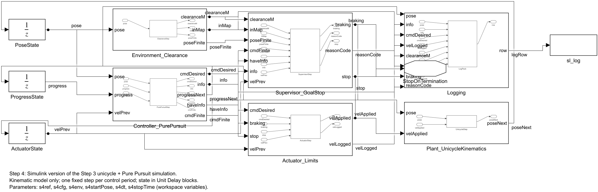
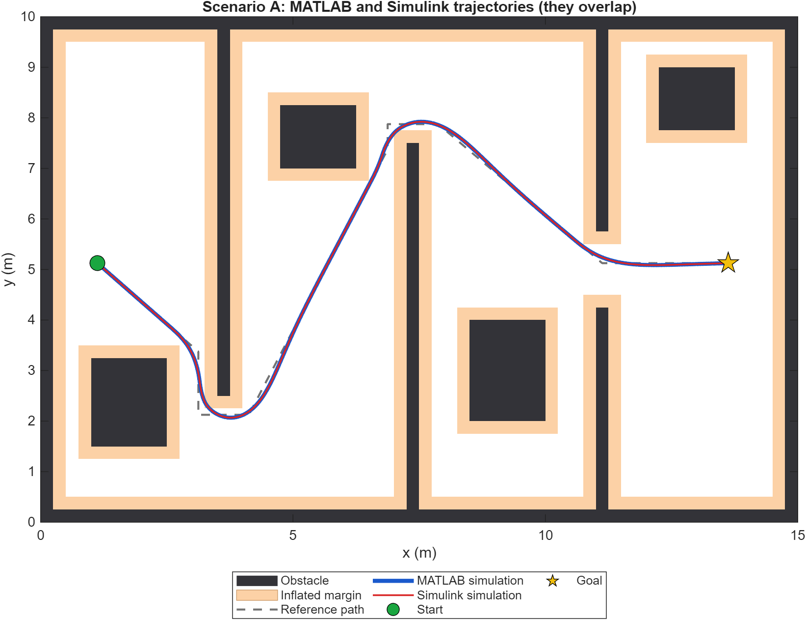
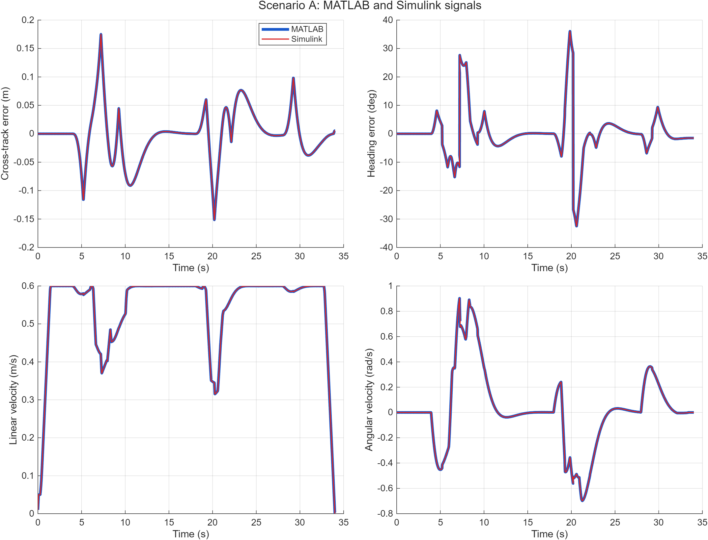
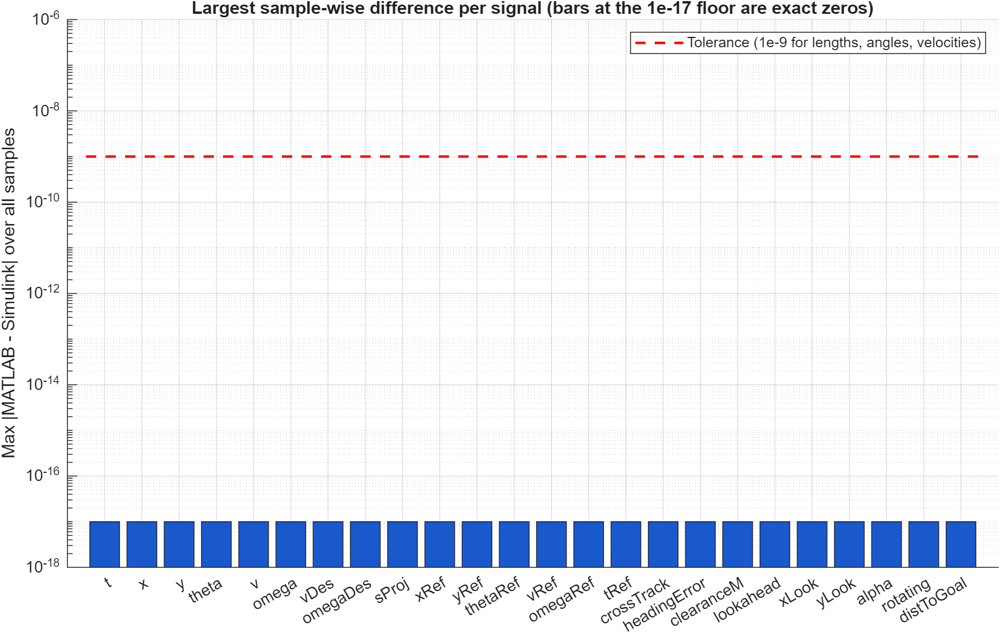
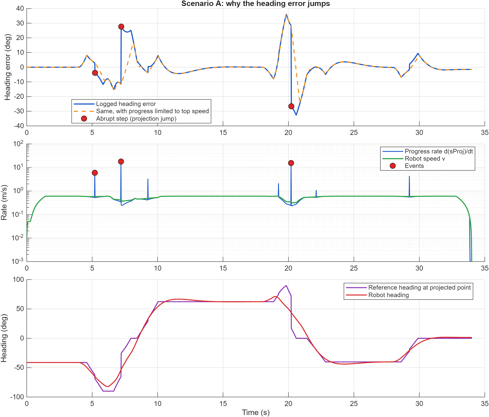
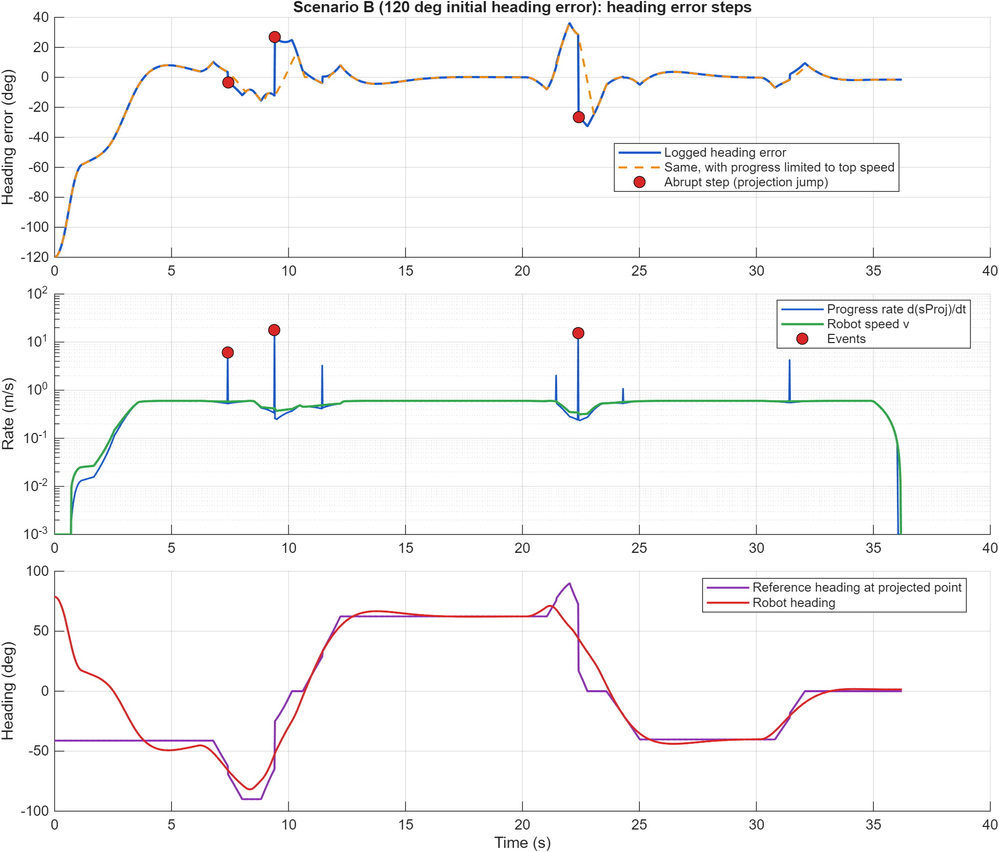

Logs: `results/step4_log.txt`, `step4_comparison.csv` (metrics), `step4_scenarios.csv`, `step4_heading_error_events.csv`, `step4_simulink_log.csv` (all 27 logged signals at every step of Scenario A).

### Step 4 tests

`tests/testStep4.m` has 18 tests: model structure and solver settings; a clean nominal run; sample-by-sample and metric agreement with MATLAB; braking and acceleration limits in Simulink; the trajectory checked against the real map; all eight failure and goal-stop scenarios against MATLAB; sensitivity of the comparison; determinism; the ODE cross-check; the supervisor, actuator, plant and clearance block functions called directly (goal entry, standstill inside and outside the tolerance, timeout and stall step counts); log layout; the comparison function itself (wrapping, NaN, step counts); and the heading-error classifier, including a synthetic wrap case.

### Step 4 limitations

- Kinematic simulation only; nothing here is dynamic, physical or hardware validation, and no code was generated from the model.
- The model wraps MATLAB code in MATLAB Function blocks instead of re-implementing the controller with native Simulink blocks. Exact agreement is therefore expected and does not independently validate the control algorithm.
- The model needs its workspace variables; use `runSimulinkTracking` rather than running it directly.
- The stall detector keeps 4096 steps of history, which allows stall windows up to about 81 s at 0.02 s.
- A Simulink run takes a few seconds, against about 0.5 s for the MATLAB simulation.
- The projection discontinuity described above is unchanged in the baseline.

## Verification and reproducibility

Maps are defined deterministically in `createOccupancyMap.m`, and no random numbers are used anywhere in the planners, controller or simulations.

Final quality review (Windows 11, MATLAB R2025a 25.1):

- A copy of the project with `results/` and `simulink/` deleted was run in a fresh MATLAB process (`matlab -batch`, no `startup.m`, nothing of the project on the path). The four scripts ran in the documented order (18 s, 12 s, 21 s and 112 s, including building the model) and `runtests('tests')` passed 87 of 87 tests (11 + 32 + 26 + 18).
- The regenerated files match the committed ones: all 7 CSV files are identical, and the logs are identical apart from two absolute file paths in the Step 4 log.
- The 20 regenerated figures contain the same data but are not pixel-identical to the committed ones (0.0% to 2.2% of pixels differ, from text and line rendering in a headless session). Figures were checked by pixel statistics and file inspection, not by eye.
- The Simulink instructions above (setting the `s4*` variables and calling `sim`) were run as written, with `load_system` in place of `open_system` because no display was used, and ended in `goal_reached` after 1702 steps.

Not verified: MATLAB R2024b or any other release, Linux, and any use of the model beyond Normal-mode simulation. Everything is a kinematic simulation; there is no hardware or dynamic validation.

## Known limitations

- Inflation is quantised to whole cells. With 0.25 m cells the 0.25 m inflation is exact here, but other radii are rounded up. A 2-cell inflation (0.45 m radius + 0.05 m margin) closes the narrow passages of this map.
- A 1-cell inflation kernel is a 3x3 square, which is more conservative than a true disk near diagonals.
- Smoothing is greedy line-of-sight shortcutting. It does not give the shortest possible any-angle path, and waypoints stay on A* cell centres.
- The smoothed path has sharp corners and ignores robot kinematics and orientation. It is a geometric path, not a dynamically feasible trajectory.
- The robot is treated as a circle moving freely in any direction (holonomic point-plus-radius model).
- Clearance is measured to occupied cells treated as full squares, and the map border is part of the grid as obstacle cells.
- The A* open list is scanned linearly; a binary heap would scale better to large maps.
